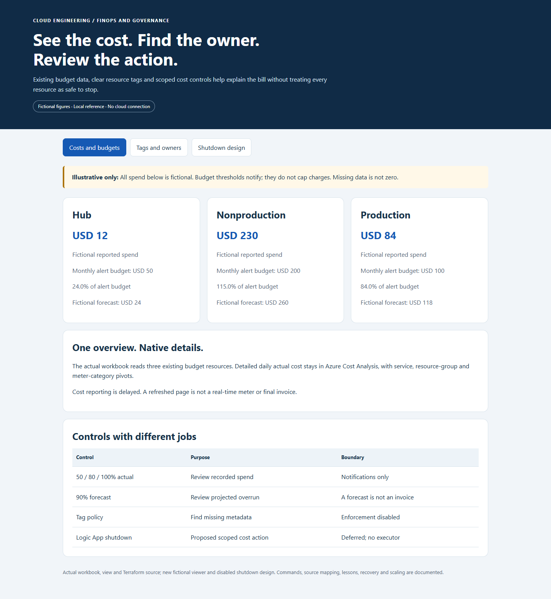
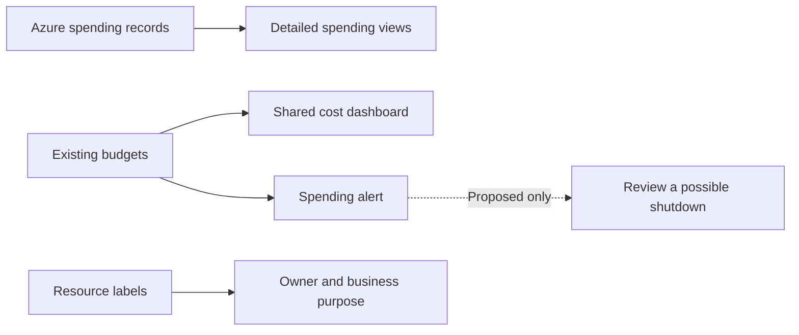
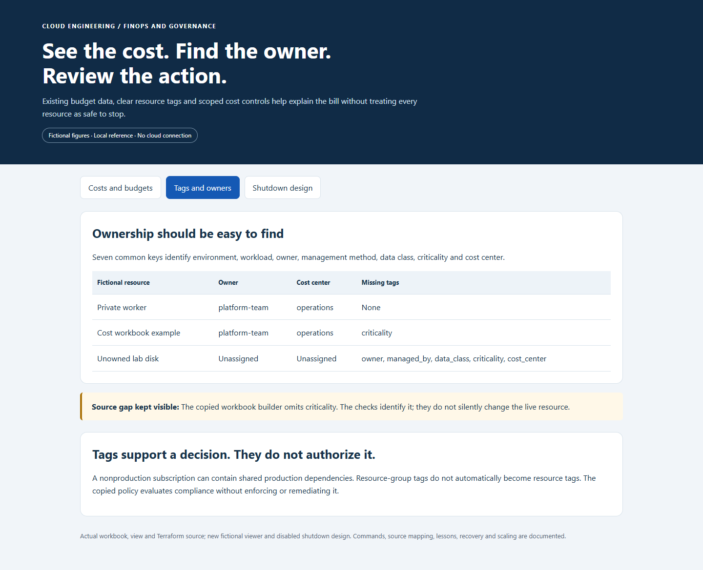

# Azure Cost Visibility, Tagging and FinOps

**See where cloud money goes, who owns each resource and what to review before reducing costs.**

[Business problem](#the-business-problem) · [Strengths](#engineering-strengths) · [What was built](#what-was-built) · [Shutdown design](#logic-app-shutdown-design) · [Proof](#proof-it-works) · [Commands](docs/COMMANDS.md) · [Step by step](#step-by-step)



## The Business Problem

The organization needs to explain cloud spending across production, testing and shared engineering services. A total bill does not identify which workload produced a charge, whether the resource is still needed or who can safely change it. Inconsistent resource labels make that investigation more manual.

Pausing an application does not stop every related charge: networking, storage, retained images and other supporting services may continue billing. A resource labelled nonproduction can also have a live dependency, so deleting it based on its name alone can interrupt production. Budget alerts arrive as information and do not impose a spending ceiling.

The business need was usable cost visibility, reliable ownership labels and a deliberate shutdown review that reduces avoidable spending while preserving service dependencies and recovery data.

## The Solution

I brought the existing budgets into one Azure dashboard and kept detailed spending breakdowns in Azure Cost Management. Resource tags—labels such as owner, environment and cost center—help connect charges to the responsible team.

**Business outcome:** Engineers can investigate spending before changing services. Budget alerts prompt a review; they do not stop spending automatically. The public examples use fictional costs.

## Tools Used and What They Do

| Tool or service | What it does | Where it fits |
| --- | --- | --- |
| Azure Cost Management | Inspect actual reported spend, saved views and budgets. | Actual billing/visibility service; Resource Graph is not a replacement for spend data. |
| Azure Monitor Workbooks | Display the existing budget information in one view. | Actual workbook design; no new cost-ingestion pipeline is implied. |
| Azure Resource Graph | Find resources and their ownership/tag metadata. | Inventory query service, not an authoritative billing meter. |
| Azure Policy | Evaluate selected configuration/tagging expectations. | Policy effect and enforcement mode must be read; a name does not prove enforcement. |
| Python, Azure CLI and Terraform | Build/check views and describe related configuration. | Source/operating utilities; local checks do not refresh a private invoice. |
| Logic Apps | Represent the proposed budget-triggered shutdown sequence. | Design only; automatic shutdown is not deployed by this reference. |

Stopping compute and removing a private endpoint have different billing and recovery consequences. GitHub Actions validation is manual-only and does not change budgets or power states.

## Step by Step

A short walkthrough of the process, with technical instructions and evidence limits in the sections below.

1. **Read the spending overview (Cost Management and Workbooks)** — The dashboard shows existing budgets and reported spending. Detailed Azure views help explain which services contribute to the bill.

2. **Find the responsible owner (Resource Graph and tags)** — Resource labels identify the environment, purpose and owner. Missing labels are reported so someone can investigate them.

3. **Review the cost action** — An alert prompts a review of the resource and its dependencies. A test environment label alone does not mean that a resource is safe to stop.

4. **Separate reporting from shutdown** — The budget-triggered shutdown example remains a disabled design. Real changes require their own checks and recovery plan, and retained resources may still incur charges.

## Engineering Strengths

| Design choice | Practical benefit |
| --- | --- |
| Reuse existing budget information | Avoid another data collection system just to show costs. |
| Label resources consistently | Make it easier to find an owner and understand a resource's purpose. |
| Separate recorded spending from forecasts | Help readers distinguish charges already reported from estimates of future spending. |
| Report missing tags without blocking changes | Give owners a chance to correct gaps without unexpected service disruption. |
| Review shutdown plans separately | Avoid stopping a shared or busy service just because a budget alert arrived. |

## Architecture



FinOps means managing cloud spending with both business and engineering needs in mind. A budget is an alert threshold, not a spending limit.

## What Was Built

| Part | What it does | Details |
| --- | --- | --- |
| Shared dashboard | Shows existing budgets and reported spending. | [Dashboard builder](scripts/build_cost_visibility_workbook.py) |
| Detailed spending views | Breaks spending down by service and resource group. | [View setup](reference/ensure_cost_visibility_views.py) |
| Budget alerts | Warns when recorded or forecast spending reaches chosen levels. | [Budget settings](infra/cost-controls/budget.tf) |
| Resource labeling rules | Helps identify owners and missing labels. | [Rules](infra/governance/main.tf) and [labels](reference/infra/common-tags.tf) |
| Daily server shutdown schedule | Provides a separate scheduled shutdown, with no automatic startup. | [Schedule](reference/infra/vm-shutdown.tf) |
| Proposed budget-triggered shutdown | Demonstrates review rules without stopping anything. | [Design](design/logic-app-shutdown-review.json) |

## Logic App Shutdown Design

Azure Logic Apps connects scheduled tasks and events to processing steps. I explored using it to review a possible shutdown after a budget alert.

**This part remains a design, not working shutdown automation.** The example is disabled and cannot stop resources. A real implementation would need to verify the alert, check current dependencies and activity, identify exactly what may stop, and provide a recovery plan.

Stopping a server also does not remove every charge: disks, storage and other retained resources can still cost money. [Design and safeguards](docs/SHUTDOWN-DESIGN.md).

## Proof It Works

Recorded local checks covered the dashboard builder, resource labels and the proposed review rules: **16 tests passed**, plus **four infrastructure test cases using simulated Azure responses**.

One useful finding remained visible: the dashboard's resource-label view included six of the seven common tag keys and omitted `criticality`, which describes how important a resource is. The project reports that gap rather than claiming complete coverage.

The screenshots are local examples with fictional costs. These checks did not query a live bill or stop cloud services. [Full results](docs/VALIDATION.md).

<details>
<summary>For engineers: detailed results, examples and commands</summary>

### 1. Check the real builders and fictional decision models

```bash
python -B -m unittest discover -s tests -v
python -B scripts/demo.py
python -B scripts/build_cost_visibility_workbook.py --output .local-workbook.json
```

**Observed: 16 local tests passed.** The builder writes a local ARM file only. Tests check budget reads, saved-view behavior, missing data, tag gaps and disabled shutdown planning. They do not query Azure billing or change resources. [Validation](docs/VALIDATION.md).

### 2. Check which tags are included



The actual workbook builder includes six of the seven common keys and omits `criticality`. The public checks expose that gap; they do not claim every resource is compliant or silently alter the copied implementation. Resource tags do not automatically inherit from a resource group.

### 3. Validate budget and governance settings without Azure

```bash
terraform -chdir=infra/cost-controls init -backend=false
terraform -chdir=infra/cost-controls fmt -check -recursive
terraform -chdir=infra/cost-controls validate
terraform -chdir=infra/cost-controls test
terraform -chdir=infra/governance init -backend=false
terraform -chdir=infra/governance validate
terraform -chdir=infra/governance test
```

**Observed: all four Terraform mock cases passed**, along with formatting and validation. Tests use simulated provider responses. No Terraform apply, tag update, budget recipient change or Azure shutdown is performed.

### 4. Open the local reference

```bash
python -B scripts/preview.py --port 8143
```

Open [the local reference](http://127.0.0.1:8143). Figures and resources are fictional. Screenshots are actual local captures, not a fresh Azure cost report or portal acceptance test.

</details>

## Troubleshooting Lessons

Paused applications still incurred private-endpoint charges. The cost pause preserved a production dependency hosted in the nonproduction environment and retained the information needed to restore testing. [Read the incident, evidence and verification](docs/LESSONS-LEARNED.md).

## Guides

- [Implementation and evidence boundaries](docs/IMPLEMENTATION.md)
- [Tagging and ownership](docs/TAGGING.md)
- [Logic App shutdown design](docs/SHUTDOWN-DESIGN.md)
- [Issues and lessons](docs/LESSONS.md)
- [Commands, queries and clickops](docs/COMMANDS.md)
- [Operations, scaling and tradeoffs](docs/OPERATIONS-AND-SCALING.md)
- [Source map](docs/SOURCE-MAP.md)
- [Validation](docs/VALIDATION.md)

No Azure service is started, stopped or deployed for this project. The public GitHub check is manual-only and is not dispatched during publication.
