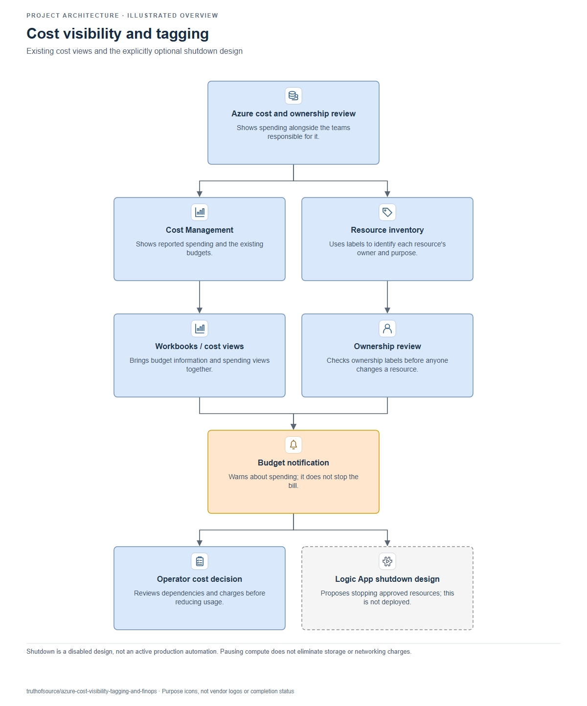

# Azure Cost Visibility, Tagging and FinOps

[](docs/diagrams/architecture.svg)

[View SVG](docs/diagrams/architecture.svg) · [Download PNG](docs/diagrams/architecture.png) · [Edit in draw.io](docs/diagrams/architecture.drawio)

**See where cloud money goes, who owns each resource and what to review before reducing costs.**

[Business problem](#the-business-problem) · [Strengths](#engineering-strengths) · [What was built](#what-was-built) · [Shutdown design](#logic-app-shutdown-design) · [Proof](#proof-it-works) · [Commands](docs/COMMANDS.md) · [Step by step](#step-by-step)

## The Business Problem

The organization needs to explain cloud spending across production, testing and shared engineering services. A total bill does not identify which workload produced a charge, whether the resource is still needed or who can safely change it. Inconsistent resource labels make that investigation more manual.

Pausing an application does not stop every related charge: networking, storage, retained images and other supporting services may continue billing. A resource labelled nonproduction can also have a live dependency, so deleting it based on its name alone can interrupt production. Budget alerts arrive as information and do not impose a spending ceiling.

The business need was usable cost visibility, reliable ownership labels and a deliberate shutdown review that reduces avoidable spending while preserving service dependencies and recovery data.

## The Solution

I brought the existing budgets into one Azure dashboard and kept detailed spending breakdowns in Azure Cost Management. Resource tags—labels such as owner, environment and cost center—help connect charges to the responsible team.

**Business outcome:** Engineers can investigate spending before changing services. Budget alerts prompt a review; they do not stop spending automatically. The public examples use fictional costs.

## Tools Used and What They Do

| Tool or service | What it does | Where it fits |
| --- | --- | --- |
| Azure Cost Management | Inspect actual reported spend, saved views and budgets. | Actual billing/visibility service; Resource Graph is not a replacement for spend data. |
| Azure Monitor Workbooks | Display the existing budget information in one view. | Actual workbook design; no new cost-ingestion pipeline is implied. |
| Azure Resource Graph | Find resources and their ownership/tag metadata. | Inventory query service, not an authoritative billing meter. |
| Azure Policy | Evaluate selected configuration/tagging expectations. | Policy effect and enforcement mode must be read; a name does not prove enforcement. |
| Python, Azure CLI and Terraform | Build/check views and describe related configuration. | Source/operating utilities; local checks do not refresh a private invoice. |
| Logic Apps | Represent the proposed budget-triggered shutdown sequence. | Design only; automatic shutdown is not deployed by this reference. |

Stopping compute and removing a private endpoint have different billing and recovery consequences. GitHub Actions validation is manual-only and does not change budgets or power states.

## Step by Step

Your own tagged Azure lab, budget notifications, cost view and a narrowly scoped optional shutdown design.

[Open the standalone build guide](docs/BUILD-YOUR-OWN.md) or follow the same complete instructions below.

Start with a new folder, your own files and your own accounts. The numbered steps below describe the build; no portfolio repository checkout is required. The existing implementation/evidence elsewhere in this repository is a separate reference, not a claim that your new build has already passed.

### Prerequisites

Azure subscription with resource/tag, cost/budget and optional Logic App permissions; an approved notification mailbox and a realistic lab budget. A budget alert is not an automatic spending limit.

Use Bash on Linux/macOS/WSL for Bash blocks and PowerShell for PowerShell blocks. Select the tool versions supported by the official sources below, record the versions you actually install and retain generated dependency locks. Cloud resources, scanner downloads, logs and external AI calls can create costs; review the stated scope before enabling them.

### Create your project folder

Choose a new folder name. These first commands create a blank project; an optional `git init` gives it its own history. Create parent directories in your editor when a later step introduces a nested file.

```bash
mkdir my-azure-cost-visibility-tagging-and-finops
cd my-azure-cost-visibility-tagging-and-finops
git init
```

Create `.gitignore` before saving credentials or build outputs:

```gitignore
.venv/
node_modules/
.env
.env.*
local.settings.json
credentials.json
token.json
*.pem
*.key
*.tfstate*
*.tfplan
.terraform/
private*/
captures/
backups/
batch.json
reports/
out/
app-config.local.yaml
```

The source/file snippets are a starting implementation you type or paste into the named files. Replace `YOUR_*`, names, regions and addresses only with values from your own lab; do not place real client/employee records in a test project. Keep your terminal in this project root unless a step explicitly changes directory.

Before a first commit, set your own repository-local author with `git config user.name "YOUR_NAME"` and `git config user.email "YOUR_PUBLIC_COMMIT_EMAIL"`. Review `git status --short` and the staged diff before publishing; ignored local files are not a substitute for reviewing what you upload.

### Step 1 — Define ownership and tags

**Where:** Your own tagging.md file.

Choose environment, owner, costCenter and service tags, including who may change them. Decide how missing or inconsistent tags will be reviewed rather than assuming tags enforce a security boundary.

**Check before continuing:** You have a small tagging standard that matches the business ownership model.

### Step 2 — Create and tag a dedicated lab group

**Where:** Azure Portal → Resource groups → Create → Tags.

Create a group for your own project with the chosen tags and apply them to supported child resources. Verify actual child tags; a resource group tag is not automatically inherited unless you configure an appropriate policy/process.

**Check before continuing:** Your group/resources have the expected ownership metadata.

### Step 3 — Create your cost view

**Where:** Subscription → Cost Management → Cost analysis.

Choose a period, actual versus amortized cost basis, currency and grouping by service/resource group/tag. Record untagged costs, data freshness and shared-resource attribution limits so the chart does not imply every charge belongs neatly to one app.

**Check before continuing:** The saved view answers who owns the spend and what basis it uses.

### Step 4 — Configure a budget and verify the route

**Where:** Cost Management → Budgets → Add.

Select your scope/amount/time period and add deliberate actual/forecast thresholds with an approved email/action route. Confirm recipient verification and the test/observed notification separately from the existence of the budget object.

**Check before continuing:** The budget settings and notification delivery evidence are recorded; no spending cap is claimed.

### Step 5 — Design an optional Logic App shutdown for one lab VM

**Where:** Logic App Designer; managed identity and VM IAM.

Create a disabled recurrence workflow, enable its managed identity and grant only the reviewed read/deallocate operations at the one lab VM scope. Add an authenticated ARM read of that exact VM, check an explicit owner-approved shutdown tag/window, then a bounded POST to its deallocate action; keep the workflow disabled until dependencies and recovery are tested.

**Check before continuing:** The design cannot select arbitrary VMs and does not treat stopping an OS as complete cost removal.

### Step 6 — Test the decision before activation

**Where:** Your selected lab VM and workflow history.

First run an observation-only version that records whether this exact VM would qualify. If you later approve the lab action, verify deallocation and a tested restart/access path; do not stop production/provider jobs to obtain a screenshot.

**Check before continuing:** Any real shutdown has an observed target, outcome and recovery result.

### Step 7 — Review residual spend and close out

**Where:** Cost analysis and your inventory.

Compare the observation period with disks, IPs, backups, logs, registry images and other retained services. Disable/delete your lab automation and remove only your lab resources after recording the remaining charges and owners.

**Check before continuing:** Your savings explanation includes ongoing storage/network costs and reporting delay.

### Verification and your own screenshots

| Evidence | What to record | Your result |
| --- | --- | --- |
| New build | Your own files/resource settings and tool versions | Not yet recorded |
| Working path | The actual successful request, configuration or recovery result | Not yet recorded |
| Failure boundary | A meaningful denied, malformed, stale or failed case | Not yet recorded |
| Recovery / cleanup | What you restored or removed and what remains billed | Not yet recorded |

Capture your own architecture/configuration, one working result and one failure/recovery result. Keep tokens, credentials, personal records and private identifiers out of public screenshots. The architecture diagram explains the design; record your own results rather than treating it as execution evidence.

### Troubleshooting order

1. Confirm the named file, working directory and selected tool/interpreter.
2. Check the exact input and resource/account selected for the failing step.
3. Separate identity permission, network/DNS reachability and application validation.
4. Keep the actual error and reconcile an unknown write outcome before repeating it; do not widen access or repeat paid operations blindly.

The numbered steps describe a build procedure. Local syntax checks, an accepted API request, a completed hosted operation and a human verification are different evidence levels; fill in the verification table with what you actually observed.

### Official implementation references

- [learn.microsoft.com — quick-acm-cost-analysis](https://learn.microsoft.com/en-us/azure/cost-management-billing/costs/quick-acm-cost-analysis)
- [learn.microsoft.com — tutorial-acm-create-budgets](https://learn.microsoft.com/en-us/azure/cost-management-billing/costs/tutorial-acm-create-budgets)
- [learn.microsoft.com — authenticate-with-managed-identity](https://learn.microsoft.com/en-us/azure/logic-apps/authenticate-with-managed-identity)

<details>
<summary>Reference: how the existing platform implementation operates</summary>

A short walkthrough of the process, with technical instructions and evidence limits in the sections below.

1. **Read the spending overview (Cost Management and Workbooks)** — The dashboard shows existing budgets and reported spending. Detailed Azure views help explain which services contribute to the bill.

2. **Find the responsible owner (Resource Graph and tags)** — Resource labels identify the environment, purpose and owner. Missing labels are reported so someone can investigate them.

3. **Review the cost action** — An alert prompts a review of the resource and its dependencies. A test environment label alone does not mean that a resource is safe to stop.

4. **Separate reporting from shutdown** — The budget-triggered shutdown example remains a disabled design. Real changes require their own checks and recovery plan, and retained resources may still incur charges.

</details>

## Engineering Strengths

| Design choice | Practical benefit |
| --- | --- |
| Reuse existing budget information | Avoid another data collection system just to show costs. |
| Label resources consistently | Make it easier to find an owner and understand a resource's purpose. |
| Separate recorded spending from forecasts | Help readers distinguish charges already reported from estimates of future spending. |
| Report missing tags without blocking changes | Give owners a chance to correct gaps without unexpected service disruption. |
| Review shutdown plans separately | Avoid stopping a shared or busy service just because a budget alert arrived. |

## Architecture

[View the illustrated project overview](docs/diagrams/architecture.svg).

FinOps means managing cloud spending with both business and engineering needs in mind. A budget is an alert threshold, not a spending limit.

## What Was Built

| Part | What it does | Details |
| --- | --- | --- |
| Shared dashboard | Shows existing budgets and reported spending. | [Dashboard builder](scripts/build_cost_visibility_workbook.py) |
| Detailed spending views | Breaks spending down by service and resource group. | [View setup](reference/ensure_cost_visibility_views.py) |
| Budget alerts | Warns when recorded or forecast spending reaches chosen levels. | [Budget settings](infra/cost-controls/budget.tf) |
| Resource labeling rules | Helps identify owners and missing labels. | [Rules](infra/governance/main.tf) and [labels](reference/infra/common-tags.tf) |
| Daily server shutdown schedule | Provides a separate scheduled shutdown, with no automatic startup. | [Schedule](reference/infra/vm-shutdown.tf) |
| Proposed budget-triggered shutdown | Demonstrates review rules without stopping anything. | [Design](design/logic-app-shutdown-review.json) |

## Logic App Shutdown Design

Azure Logic Apps connects scheduled tasks and events to processing steps. I explored using it to review a possible shutdown after a budget alert.

**This part remains a design, not working shutdown automation.** The example is disabled and cannot stop resources. A real implementation would need to verify the alert, check current dependencies and activity, identify exactly what may stop, and provide a recovery plan.

Stopping a server also does not remove every charge: disks, storage and other retained resources can still cost money. [Design and safeguards](docs/SHUTDOWN-DESIGN.md).

## Proof It Works

Recorded local checks covered the dashboard builder, resource labels and the proposed review rules: **16 tests passed**, plus **four infrastructure test cases using simulated Azure responses**.

One useful finding remained visible: the dashboard's resource-label view included six of the seven common tag keys and omitted `criticality`, which describes how important a resource is. The project reports that gap rather than claiming complete coverage.

The local examples use fictional costs; their placeholder captures have been removed. These checks did not query a live bill or stop cloud services. [Full results](docs/VALIDATION.md).

<details>
<summary>For engineers: detailed results, examples and commands</summary>

### 1. Check the real builders and fictional decision models

```bash
python -B -m unittest discover -s tests -v
python -B scripts/demo.py
python -B scripts/build_cost_visibility_workbook.py --output .local-workbook.json
```

**Observed: 16 local tests passed.** The builder writes a local ARM file only. Tests check budget reads, saved-view behavior, missing data, tag gaps and disabled shutdown planning. They do not query Azure billing or change resources. [Validation](docs/VALIDATION.md).

### 2. Check which tags are included

The actual workbook builder includes six of the seven common keys and omits `criticality`. The public checks expose that gap; they do not claim every resource is compliant or silently alter the copied implementation. Resource tags do not automatically inherit from a resource group.

### 3. Validate budget and governance settings without Azure

```bash
terraform -chdir=infra/cost-controls init -backend=false
terraform -chdir=infra/cost-controls fmt -check -recursive
terraform -chdir=infra/cost-controls validate
terraform -chdir=infra/cost-controls test
terraform -chdir=infra/governance init -backend=false
terraform -chdir=infra/governance validate
terraform -chdir=infra/governance test
```

**Observed: all four Terraform mock cases passed**, along with formatting and validation. Tests use simulated provider responses. No Terraform apply, tag update, budget recipient change or Azure shutdown is performed.

### 4. Open the local reference

```bash
python -B scripts/preview.py --port 8143
```

Open [the local reference](http://127.0.0.1:8143). Figures and resources are fictional. Proper Azure cost and portal screenshots are deferred.

</details>

## Troubleshooting Lessons

Paused applications still incurred private-endpoint charges. The cost pause preserved a production dependency hosted in the nonproduction environment and retained the information needed to restore testing. [Read the incident, evidence and verification](docs/LESSONS-LEARNED.md).

## Guides

- [Implementation and evidence boundaries](docs/IMPLEMENTATION.md)
- [Tagging and ownership](docs/TAGGING.md)
- [Logic App shutdown design](docs/SHUTDOWN-DESIGN.md)
- [Issues and lessons](docs/LESSONS.md)
- [Commands, queries and clickops](docs/COMMANDS.md)
- [Operations, scaling and tradeoffs](docs/OPERATIONS-AND-SCALING.md)
- [Source map](docs/SOURCE-MAP.md)
- [Validation](docs/VALIDATION.md)

No Azure service is started, stopped or deployed for this project. The public GitHub check is manual-only and is not dispatched during publication.
