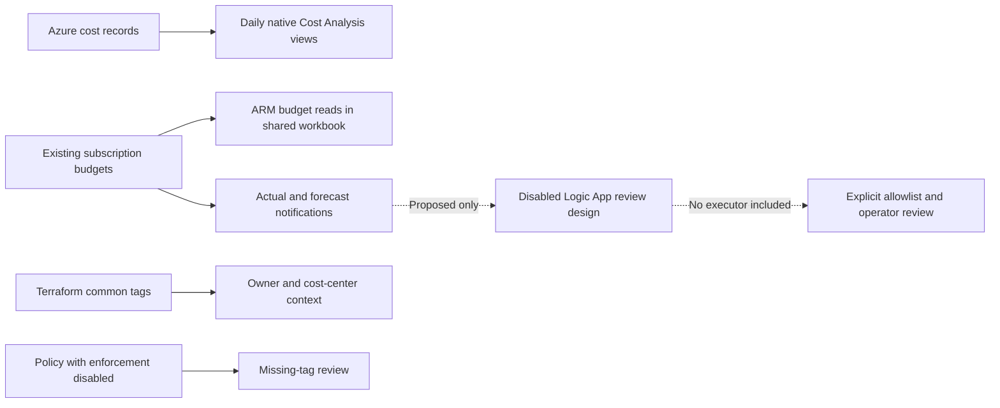
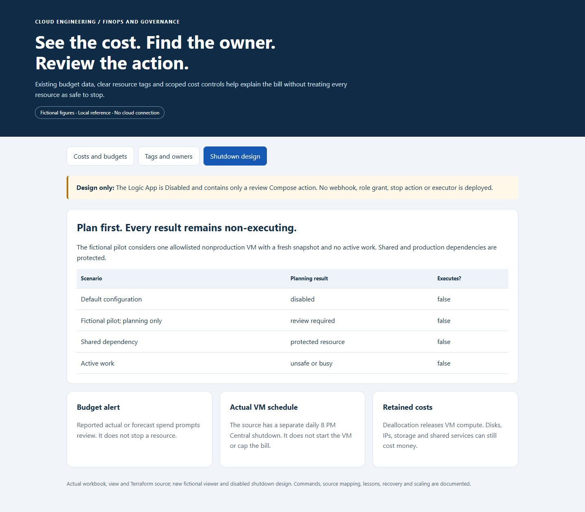

# Azure Cost Visibility, Tagging and FinOps

**Make cloud spending understandable, connect resources to owners and review cost actions before disrupting services.**

[Business problem](#the-business-problem) · [Strengths](#engineering-strengths) · [What was built](#what-was-built) · [Shutdown design](#logic-app-shutdown-design) · [Proof](#proof-it-works) · [Commands](docs/COMMANDS.md)


## The Business Problem

A platform spans production, nonproduction and shared services. A single bill does not explain which environment is driving spend, who owns a resource or why charges continue after an application is paused. Missing tags make that investigation harder. Automatically stopping everything in a nonproduction subscription could also interrupt shared production dependencies.

## The Solution

Bring existing subscription budgets into one Azure Monitor workbook, keep detailed daily analysis in native Cost Management views and apply a consistent resource-tag vocabulary. Use actual and forecast alerts to prompt review. Keep resource shutdown separate from reporting, with an explicit allowlist and recovery plan before any future budget-triggered automation.

**Business outcome:** Engineers can compare reported spend with the correct environment budget, find an owner and investigate a cost driver before changing capacity or stopping services. No savings percentage or current bill is inferred from the public example.

## Engineering Strengths

| Strength | Practical value |
| --- | --- |
| **Uses existing budget data** | The workbook reads budget resources rather than adding a second log workspace or a new ingestion pipeline just to display costs. |
| **Separates actual from forecast** | Alerts at 50/80/100% actual and 90% forecast have different meanings; a friendly label cannot substitute for the saved threshold type. |
| **Makes ownership visible** | Seven common tag keys connect an environment, workload, owner and cost center with operational context. |
| **Keeps policy behavior explicit** | The actual tag/location assignments evaluate compliance with enforcement disabled. They do not silently block deployments or repair tags. |
| **Protects existing views** | The saved-view helper checks existing views and refuses mismatches instead of overwriting them. |
| **Keeps cost actions scoped** | The proposed shutdown model rejects shared dependencies, production resources, stale observations and active work; it never executes a stop. |

## Architecture



A budget is an alert threshold, not a spending cap. The workbook does not grant cost access, change budgets or stop resources. Resource Graph inventory helps find resources and tags; it does not supply their billed spend.

## What Was Built

| Component | Status and purpose | Source |
| --- | --- | --- |
| Shared cost workbook builder | Actual implementation; three budget panels and clear reported-spend wording | [Builder](scripts/build_cost_visibility_workbook.py), [example ARM output](templates/cost-visibility.workbook.json) |
| Native saved-view helper | Actual implementation; daily actual cost, budget KPI and service/group/meter pivots | [Helper](reference/ensure_cost_visibility_views.py) |
| Monthly budget alerts | Actual extracted Terraform; public wrapper defaults Off | [Budget](infra/cost-controls/budget.tf) |
| Tag/location policy | Actual reusable module; `enforce=false` | [Governance](infra/governance/main.tf) |
| Common tagging pattern | Actual seven-key source pattern, with fictional labels | [Tags](reference/infra/common-tags.tf) |
| Scheduled VM shutdown | Actual source reference; daily 8 PM Central, without automatic startup | [VM schedule](reference/infra/vm-shutdown.tf) |
| Budget-triggered Logic App shutdown | Deferred design represented by a disabled review-only template and new local planning model | [Design](design/logic-app-shutdown-review.json), [guards](scripts/finops_reference.py) |

## Logic App Shutdown Design

The original budget-triggered shutdown idea remained deferred. It is included here as a **design and local dry run**, not a deployed solution.



The proposed sequence is budget alert → authenticated event → current resource/dependency check → exact allowlist → reviewed action → verified result and recovery record. The included Logic App is Disabled and contains only a Compose action; no webhook wiring, stop action, identity grant or executor is commissioned. Even the fictional eligible plan returns `execute: false`.

The separate implemented VM schedule is a different control. Neither a budget email nor a schedule creates a universal cost cap. Stopped-but-allocated VMs can still incur compute charges; deallocation also leaves disk and other retained-resource charges. [Shutdown boundaries](docs/SHUTDOWN-DESIGN.md).

## Proof It Works

### 1. Check the real builders and fictional decision models

```bash
python -B -m unittest discover -s tests -v
python -B scripts/demo.py
python -B scripts/build_cost_visibility_workbook.py --output .local-workbook.json
```

**Observed: 16 local tests passed.** The builder writes a local ARM file only. Tests check budget reads, saved-view behavior, missing data, tag gaps and disabled shutdown planning. They do not query Azure billing or change resources. [Validation](docs/VALIDATION.md).

### 2. Inspect tag coverage honestly


The actual workbook builder includes six of the seven common keys and omits `criticality`. The public checks expose that gap; they do not claim every resource is compliant or silently alter the copied implementation. Resource tags do not automatically inherit from a resource group.

### 3. Validate budget and governance settings without Azure

```bash
terraform -chdir=infra/cost-controls init -backend=false
terraform -chdir=infra/cost-controls fmt -check -recursive
terraform -chdir=infra/cost-controls validate
terraform -chdir=infra/cost-controls test
terraform -chdir=infra/governance init -backend=false
terraform -chdir=infra/governance validate
terraform -chdir=infra/governance test
```

**Observed: all four Terraform mock cases passed**, along with formatting and validation. Tests use simulated provider responses. No Terraform apply, tag update, budget recipient change or Azure shutdown is performed.

### 4. Open the local reference

```bash
python -B scripts/preview.py --port 8143
```

Open [the local reference](http://127.0.0.1:8143). Figures and resources are fictional. Screenshots are actual local captures, not a fresh Azure cost report or portal acceptance test.

## Guides

- [Implementation and evidence boundaries](docs/IMPLEMENTATION.md)
- [Tagging and ownership](docs/TAGGING.md)
- [Logic App shutdown design](docs/SHUTDOWN-DESIGN.md)
- [Issues and lessons](docs/LESSONS.md)
- [Commands, queries and clickops](docs/COMMANDS.md)
- [Operations, scaling and tradeoffs](docs/OPERATIONS-AND-SCALING.md)
- [Source map](docs/SOURCE-MAP.md)
- [Validation](docs/VALIDATION.md)

No Azure service is started, stopped or deployed for this project. The public GitHub check is manual-only and is not dispatched during publication.
