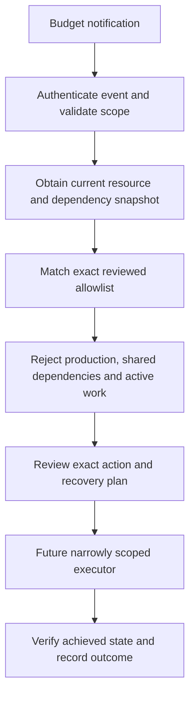

# Logic App Budget-Triggered Shutdown: Design Only

## What exists and what is proposed

| Control | Status in this case study |
| --- | --- |
| Actual/forecast budget emails | Actual implementation source |
| Backstage daily VM shutdown | Actual source reference, separate from budgets |
| Budget-to-Action Group or webhook connection | Not connected in this example |
| Logic App code that stops resources | Not implemented; deferred platform item |
| Disabled Compose-only Logic App | New public design example |
| Allowlist decisions | New local model with fictional snapshots; every output has `execute: false` |

## Intended future sequence

The included design does not implement event authentication or shutdown actions. It has no RBAC grants, ARM stop/deallocate HTTP action, active schedule or webhook registration. Its Compose output is not proof that a request is trusted. Turning it on would not add the missing authentication or permissions checks.

## Local pilot model

The model defaults disabled. With an in-memory fictional pilot flag it considers only an Actual 100% event, an exact subscription and resource allowlist, a snapshot no older than five minutes, a nonproduction VM, no shared dependency and no active work. Its only eligible result is a proposed deallocation requiring review. Forecast alerts do not authorize a shutdown.

Snapshot freshness does not make billing real time. Budget events can arrive after charges have accrued. The model does not authenticate webhooks, query Azure dependencies, persist duplicate-event handling, bind an approval, calculate a final invoice or perform recovery. Those remain requirements before real shutdown code can be implemented and used.

## Required safeguards for a real implementation

Use verified event identity, explicit approved targets and least-privilege action scopes. Record before-state, an operation identity, in-flight/queued work and the recovery owner. Recheck dependencies immediately before acting. Duplicate alerts and partial failures require durable reconciliation; do not repeat a stop/start because a post-check timed out.

Function APIs, scanners, databases, identity workers, registries and storage have different pause semantics. API Disabled is not interchangeable with every service's Stopped state. The fictional model therefore does not attempt those resource types. Never stop shared resources merely because their subscription is called nonproduction.

## Billing and recovery

VM Stopped (Allocated) can still incur compute charges. Deallocated releases the compute allocation, but retained disks, IPs, backups and other resources may still cost money. A budget cannot prevent all charges. See [Microsoft's state/billing table](https://learn.microsoft.com/en-us/azure/virtual-machines/states-billing).

Resumption must restore the intended power/configuration state, verify access and pending work, and preserve invitations, sign-in and scanning dependencies. Automatic restart is a separate policy. No live resources are paused or resumed for this project.
